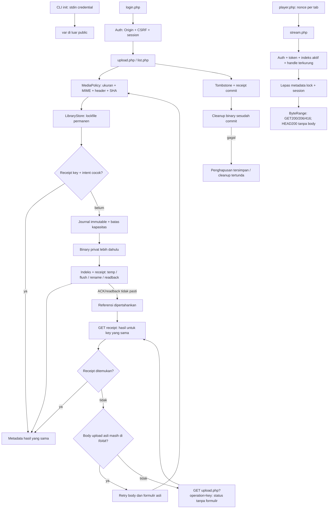

# Alur kode

Semua alur berikut adalah kontrak sumber. Verifikasi runtime masih menunggu; tidak ada klaim HTTP atau pemutaran sudah lulus.

| Tanggung jawab | Sumber |
| --- | --- |
| Origin/path/batas konfigurasi | [Config.php](../app/Config.php) |
| Credential hash, session dan token | [Auth.php](../app/Auth.php), [console.php](../bin/console.php) |
| Batas scalar, enum, key dan hash intent | [Input.php](../app/Input.php) |
| Whole-shape indeks dan konsistensi receipt/video | [IndexCodec.php](../app/IndexCodec.php) |
| IO staging, flush, rename dan exact readback | [FileOps.php](../app/FileOps.php) |
| Stable lock, journal dan kapasitas fisik | [LibraryStore.php](../app/LibraryStore.php) |
| Upload/replay/tombstone/cleanup | [LibraryService.php](../app/LibraryService.php) |
| Container, SHA dan handle binary | [MediaPolicy.php](../app/MediaPolicy.php) |
| Parser byte range murni | [ByteRange.php](../app/ByteRange.php) |
| HTML escaped, header dan response | [Web.php](../app/Web.php) |
| Entry UI dan preview | [app.js](../public/assets/app.js) |
| Capture body, receipt, retry dan recovery lifecycle | [operation-controller.js](../public/assets/operation-controller.js), [operation.js](../public/assets/operation.js) |
| Form upload pertama dan GET status tanpa formulir | [upload.php](../public/upload.php) |
| Stream response dan pelepasan lock sebelum body | [stream.php](../public/stream.php) |

Binary dan JSON bukan satu transaksi filesystem. Journal mencatat key/intent/video ID sebelum binary dipindahkan. Binary harus ada dan cocok sebelum indeks aktif diterbitkan. Kegagalan sebelum indeks meninggalkan state privat untuk diperiksa; request server dengan key dan payload yang cocok memakai ID journal yang sama. Tidak ada rollback otomatis yang menebak hasil rename.

Retry upload pada UI memerlukan body dan formulir asli yang masih dipegang controller untuk operator yang sama. Restore dalam lifecycle yang sama mempertahankan body itu; actor yang berbeda melepasnya. Setelah cold reload atau ketika body sudah tidak tersedia, missing receipt tidak membuka field atau menangkap FormData baru. Recovery upload hanya membaca hasil. Delete tetap memakai target video ID yang dicatat dalam metadata referensinya.

GET `upload.php?operation=key` mengautentikasi operator, memvalidasi query dan key, lalu membaca method receipt yang sudah ada. View mengakhiri rendering sebelum UUID baru atau formulir dibuat. Halaman ini tidak memiliki operation-state binder, form, input file, pengaturan watermark atau POST cleanup; tautan refresh/status adalah GET. Kontrol pemeriksaan dan cleanup lokal yang sudah ada tetap tersedia di library. Status server-rendered tidak otomatis menghapus metadata browser.

Kontrak ini membatasi UI pemulihan, bukan menambah registry atau aturan otorisasi server. Raw POST manual yang sah tetap mengikuti pemeriksaan journal/receipt: payload berbeda ditolak bila key sudah terikat; key tanpa journal belum membuktikan byte apa yang pernah dipilih browser. Tidak ada klaim fingerprint upload asli lintas reload dan tidak ada perubahan protocol hash/storage.

`FileOps::publish` baru menyebut publikasi terkonfirmasi setelah byte indeks dibaca ulang dan cocok. Rename yang sudah terjadi tetapi ACK-nya gagal masih dapat dikonfirmasi lewat exact readback. Bila readback tidak memastikan hasil, respons tetap uncertain dan tidak memulihkan indeks lama secara otomatis.

`LibraryService` membentuk respons mutation dari receipt yang sudah committed; pembacaan library lain bukan syarat konfirmasi. GET receipt adalah operasi terpisah. Hapus menyimpan tombstone terlebih dahulu; cleanup yang gagal tidak mengubah hasil commit menjadi false failure. `Web` mempertahankan konfirmasi saved jika penutupan session gagal, dengan flag `sessionWarning` untuk JSON atau halaman konfirmasi untuk POST formulir biasa. Error handler menjaga error awal bila close session ikut gagal.

Mutation memegang lock session hingga commit, sehingga logout dari session yang sama terurut. Stream membuka handle regular-file yang sesuai metadata di bawah read lock, lalu melepas lock metadata dan session sebelum `fseek`/body. Perubahan library setelah handle terbuka tidak menarik byte yang sudah diberikan.
